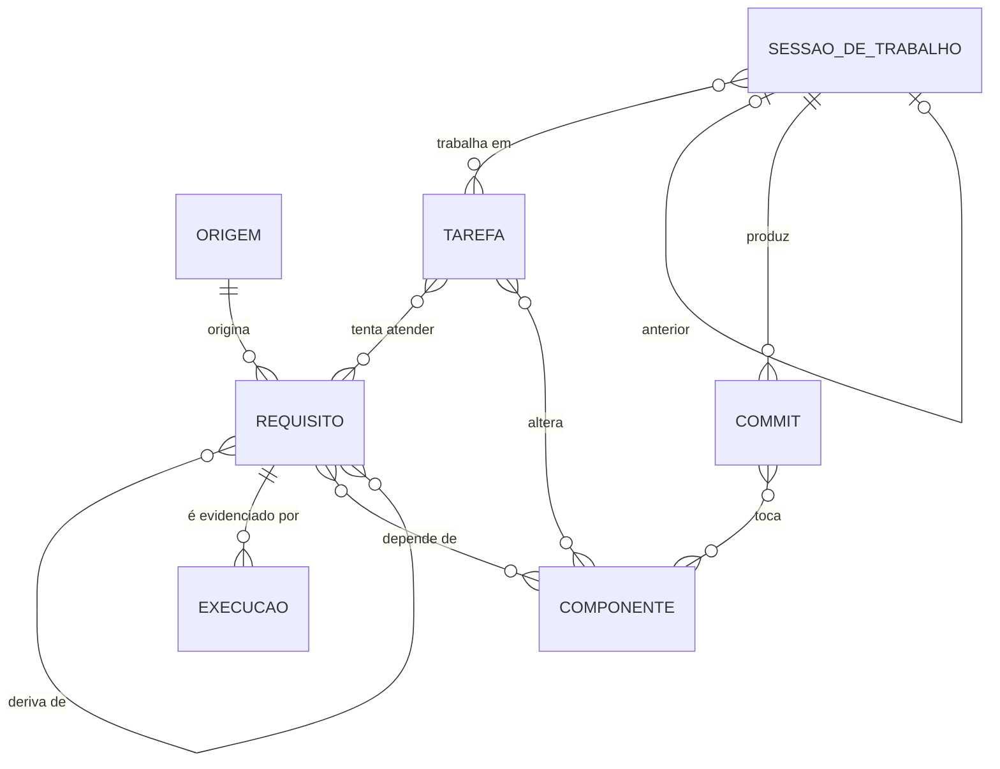

# Arquitetura do Requerial

Status: desenho inicial, ainda sem implementação.

## Tese

Requisitos atendidos geram valor; tarefas executadas, não necessariamente. Um requisito não fecha:
o que se sabe é que ele estava atendido no momento em que foi verificado. A verificação precisa se
repetir, e o requisito volta a exigir trabalho quando deixa de ser atendido.

O Requerial coordena o trabalho de humanos e agentes de IA em torno desses requisitos. Inspira-se na
rastreabilidade de ferramentas de engenharia de requisitos (vínculos entre requisitos, mudanças,
atividades e evidências de teste) e trata agentes de IA como trabalhadores de primeira classe.

## Conceitos

| Conceito | Ciclo de vida | Onde vive |
|---|---|---|
| **Requisito** | Contínuo. Nunca fecha; acumula evidências | 100% na API |
| **Tarefa** | Tem começo e fim. Tenta fazer requisitos serem (ou continuarem) atendidos | 100% na API |
| **Sessão de Trabalho** | Um chat de agente de IA, ou um período de trabalho humano | Cabeçalho na API; journal e artefatos no git |

## Entidades

- **Origem**: de onde vem um requisito. Pessoa (quem pede) ou documento (lei, norma, contrato).
- **Requisito** (`R-0001`): título, descrição, origem, organização, requisitos dos quais deriva,
  componentes dos quais depende, verificação (método, instrução, periodicidade) e estado calculado.
- **Execução**: uma rodada da verificação de um requisito, com data, resultado (passou ou falhou),
  evidência (localizador) e a sessão que a registrou.
- **Tarefa** (`T-0001`): título, descrição, organização, status, requisitos que tenta atender,
  componentes que altera e resumo para retomar.
- **Sessão de Trabalho** (`S-0001`): status, agente, chat, servidor, sessão anterior, motivo de
  encerramento, localizadores do journal e dos artefatos, tarefas, início e fim.
- **Componente**: servidor, repositório ou serviço. Pode ser restrito a um caminho
  (`repositorio:roles/web/**`), para que um commit só afete os requisitos que dependem daquela parte.
- **Commit**: hash, repositório, tarefa e sessão. Chega por um hook de `post-commit`.
- **Evento**: log append-only de toda alteração, com autor, data e sessão.

Um requisito é uma **afirmação testável** sobre o estado do mundo, no presente ("o backup tem
cópia em dois destinos independentes, verificada toda semana"), não uma ação. Existe um único
**requisito zero**, o único sem pais; todo outro deriva de algum, e o contexto de um requisito são
as suas trilhas até o zero. A derivação nunca tem ciclo.

Exemplo de cadeia:

1. Origem *diretora de operações* → Requisito *cumprir a LGPD*.
2. Origem *LGPD* → Requisito *dados pessoais com cópia de segurança fora do ambiente principal*
   (deriva do anterior).
3. Requisito *backup em dois destinos independentes, verificado semanalmente* (deriva do anterior).
4. Tarefa *configurar o segundo destino de backup*.
5. Sessão de Trabalho com agente *Claude Opus 5.5 Medium*.
6. Commit com `T-0042` no repositório de infraestrutura → componente alterado → requisitos
   dependentes ficam Suspeitos até a próxima execução.

## Estado do requisito

Duas premissas:

- **Tarefa aberta ligada a um requisito indica que ele não está atendido.**
- **Todas as tarefas concluídas não garantem que ele está.** Só uma verificação (Execução) prova.

O estado nunca é escrito à mão. O **estado próprio** vem das tarefas ligadas e da última execução;
o **estado** é o menos maduro entre o próprio e o de cada requisito abaixo (e as tarefas, a menos
madura delas manda). Um requisito sem tarefa e sem execução que se desdobra em outros é decidido só
por eles. Do menos ao mais maduro:

| Estado próprio | Regra |
|---|---|
| **Não atendido** | Alguma tarefa ligada está aberta fora de andamento, ou não há tarefa nem execução |
| **Em trabalho** | Tarefas abertas, todas em andamento |
| **Não validado** | Todas as tarefas ligadas concluídas e nenhuma execução |
| **Validação expirada** | A última execução passou do prazo de validade |
| **Validado** | A última execução está no prazo (ou não tem prazo) |

Execução é a verificação de conformidade, inclusive manual: evidência (o que foi verificado e como),
quando e a validade em dias. Para mudar o estado, registra-se uma nova execução.

No backlog: execução que falha (**Falhado**) e **Suspeito** (um commit tocou um componente do
requisito depois da última execução).

A tela inicial é a de Requisitos, filtrada por estado: os que casam aparecem sob o caminho que vem
do zero até eles, e só eles.

O estado Suspeito **não** afirma que houve regressão. Ele sinaliza um impacto possível e prioriza a
reverificação: quando a verificação é automatizada, o commit dispara a execução e o estado se
resolve sozinho; quando é manual, o requisito entra na fila de reconferência. Quem detecta
regressão de fato é a verificação automatizada rodando periodicamente.

## Sessão de Trabalho

- **Agente** é obrigatório e imutável, sempre com o provider na frente:
  `Claude Opus 5.5 Medium`, `Claude Fable 5.1 High`, `OpenAI <modelo> <esforço>`, ou um humano.
  Assim, avaliar o resultado de uma sessão por agente é uma consulta direta.
- **Troca de agente no meio do chat** encerra a sessão. O hook bloqueia a mensagem e pede
  confirmação; confirmada, a sessão atual termina com motivo `troca de agente` e nasce outra com
  `anterior` apontando para ela, herdando as tarefas. A troca fica marcada como sinal de baixa
  confiança na avaliação.
- **Cada tarefa tem no máximo uma sessão ativa.** O repasse entre sessões é explícito, por
  `anterior`.
- **Journal e artefatos** ficam no git, livres, num único repositório privado de journals para
  todas as organizações. O cabeçalho guarda localizadores com o servidor:
  `<maquina>:<caminho>` durante a sessão e `github.com/<dono>/<repo>@<commit>:<caminho>` depois de
  persistida.
- **Ao encerrar**, um resumo é sincronizado na Tarefa. O próximo agente o recebe no início da
  sessão e, se precisar de mais contexto, chega às sessões anteriores pela API.
- Sessões humanas são opcionais, registradas pela CLI ou pelo webapp.

### Ciclo de uma sessão de agente (hooks)

Hooks são código executado pelo cliente do agente; não gastam tokens, exceto o resumo injetado no
início.

1. **Início**: abre a sessão (agente, chat, servidor), injeta o resumo da tarefa e os requisitos
   ligados. Recusa se a tarefa já tem sessão ativa.
2. **A cada mensagem**: compara o agente atual (modelo e esforço) com o cabeçalho. Se mudou,
   bloqueia e pede confirmação para o repasse.
3. **A cada commit**: o hook do git envia hash, repositório e a tarefa citada na mensagem.
4. **Fim**: grava o resumo na tarefa, persiste o journal e atualiza o localizador.

Para o Claude Code, a detecção usa os hooks de troca de modelo e a variável `$CLAUDE_EFFORT`; a
statusline também recebe modelo e esforço. Ainda falta validar na prática.

## Invariantes impostas pelo servidor

- Todo requisito tem origem.
- O estado do requisito nunca é escrito à mão.
- Requisito e Tarefa têm organização; quando não informada, o servidor usa a do pai.
- Cada tarefa tem no máximo uma sessão de trabalho ativa.
- O agente de uma sessão nunca muda.
- Toda alteração gera um evento no log, com autor, data e sessão.

Regras escritas em instruções para agentes são pedidos; estas são impostas, porque a escrita só
acontece pela API.

## Tecnologia

| Camada | Escolha | Motivo |
|---|---|---|
| Backend | Go | Compila em segundos, biblioteca padrão rica, binário único |
| Banco | SQLite (WAL) | Um único processo escreve; volume e concorrência muito acima do necessário. Migrations versionadas; Litestream para backup |
| Frontend | React + Vite + TypeScript, Tailwind, shadcn/ui, TanStack Query | Ciclo rápido, muitos exemplos para agentes. Build embutido no binário Go |
| Contrato | OpenAPI | Fonte única: `oapi-codegen` gera o servidor Go, `openapi-typescript` gera os tipos do frontend |
| Agentes | Servidor MCP | Ferramentas tipadas sobre o mesmo contrato |
| Acesso | Tailscale (`tsnet`) | Nenhuma porta pública; identidade do usuário por conexão, sem senha; HTTPS automático |

Agentes se autenticam pela rede privada e recebem, ao abrir a sessão, um token da Sessão de
Trabalho, enviado em toda chamada. O servidor atribui cada alteração à sessão e recusa escrita com
token de sessão encerrada.

## Configuração particular

Este repositório é público e não contém dados de nenhuma instalação. A configuração de cada
instalação fica num repositório privado separado, cifrada com **sops + age**: cada arquivo tem dois
destinatários, a chave age da máquina (o servidor lê sozinho) e uma chave de recuperação mantida
fora da máquina.

## Lançador de agentes

O Requerial é a fonte única do status. Entrar em `em_andamento` sem sessão ativa, por alguém que
não é uma sessão, sobe um agente (tmux, comando configurável) com `REQUERIAL_TAREFA` no ambiente;
sair de `em_andamento` por mão de outro pede ao agente vivo que encerre com resumo, sem mexer no
status. Sem agente vivo, a sessão é encerrada à mão pelo frontend. O journal de cada sessão fica na
pasta dela, `<journals>/S-0001/`, criada pelo MCP.

## Ordem de construção

1. Tarefas e Sessões de Trabalho, com os hooks do agente.
2. Origens, Requisitos e Execuções, com o estado calculado.

## Backlog

- Estado **Suspeito**: Componentes, recebimento de Commits pelo hook de `post-commit` e marcação dos
  requisitos dependentes. Fica fora da primeira versão; até lá, o estado vem só das execuções e da
  periodicidade.

## Em aberto

- Validar a detecção de modelo e esforço pelos hooks.
- Consultas do MCP para agentes (tarefas relacionadas, do mesmo requisito, recentes): entram quando
  o uso mostrar quais são úteis, sempre devolvendo o mínimo de campos. A listagem completa de
  tarefas é só do frontend; no MCP ela custa dezenas de milhares de tokens sem ajudar o agente.
